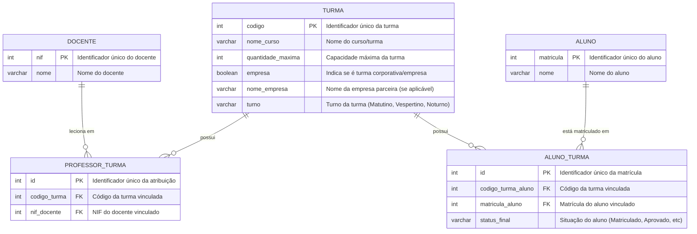

# Sistema de Gestão Escolar - Banco de Dados (Vercel Postgres)

Este projeto contém a modelagem e os scripts SQL para o banco de dados do **Sistema de Gestão Escolar**, projetado para ser executado com as ferramentas nativas de banco de dados do ambiente **Vercel** (Vercel Postgres / Neon).

---

## 📊 Diagrama Entidade-Relacionamento (ERD)

---

## 🗄️ Estrutura das Tabelas

1. **`docente`**:
   - `nif` (INT, Primary Key)
   - `nome` (VARCHAR(150), NOT NULL)

2. **`aluno`**:
   - `matricula` (INT, Primary Key)
   - `nome` (VARCHAR(150), NOT NULL)

3. **`turma`**:
   - `codigo` (INT, Primary Key)
   - `nome_curso` (VARCHAR(150), NOT NULL)
   - `quantidade_maxima` (INT, NOT NULL)
   - `empresa` (BOOLEAN, DEFAULT FALSE)
   - `nome_empresa` (VARCHAR(150), NULL)
   - `turno` (VARCHAR(50), NOT NULL)

4. **`professor_turma`** (tabela associativa docente ↔ turma):
   - `id` (INT, Primary Key gerado automaticamente)
   - `codigo_turma` (INT, Foreign Key para `turma.codigo`)
   - `nif_docente` (INT, Foreign Key para `docente.nif`)
   - *Constraint:* Chave única em `(codigo_turma, nif_docente)` para evitar duplicidade.
   - *View de compatibilidade:* `turma_docente`.

5. **`aluno_turma`** (tabela associativa aluno ↔ turma):
   - `id` (INT, Primary Key gerado automaticamente)
   - `codigo_turma_aluno` (INT, Foreign Key para `turma.codigo`)
   - `matricula_aluno` (INT, Foreign Key para `aluno.matricula`)
   - `status_final` (VARCHAR(50), NOT NULL, default `'Matriculado'`)
   - *Constraint:* Chave única em `(codigo_turma_aluno, matricula_aluno)`.
   - *View de compatibilidade:* `turma_aluno`.

---

## 🚀 Como Executar no Ambiente Vercel

O Vercel disponibiliza a ferramenta nativa **Vercel Postgres** (baseada em PostgreSQL serverless pela Neon). Para criar o esquema:

1. Acesse o [Dashboard da Vercel](https://vercel.com/dashboard).
2. Vá na aba **Storage** (ou no seu projeto `nutriteste` -> **Storage**).
3. Se ainda não criou, clique em **Create Database** e selecione **Postgres**.
4. Conecte o banco de dados ao projeto `nutriteste`.
5. No painel do banco criado na Vercel, clique na aba **Query** (Console SQL interativo).
6. Copie e cole todo o conteúdo do arquivo [`schema.sql`](./schema.sql) e clique em **Run Query**.
7. (Opcional) Copie e execute o arquivo [`seed.sql`](./seed.sql) para testar a inserção de dados e as consultas de junção.
