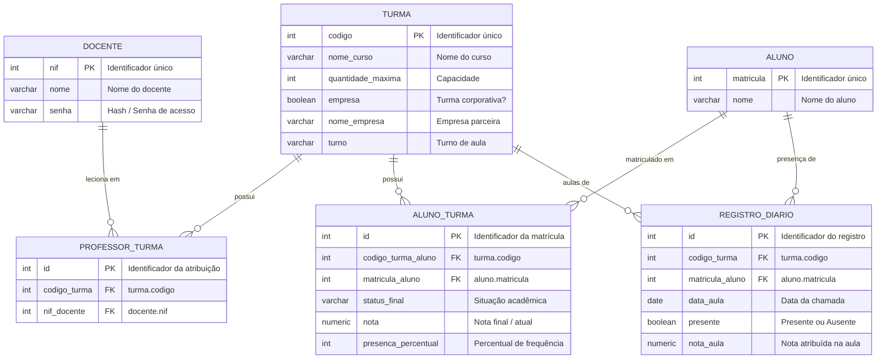

# 🎓 Diário Escolar Eletrônico & Gestão Acadêmica

Sistema completo de **Diário Escolar Eletrônico**, construído com **Next.js 14 (App Router)** e integrado às ferramentas nativas de banco de dados do ambiente **Vercel** (**Vercel Postgres** / Neon).

---

## 📸 Telas e Funcionalidades Desenvolvidas

### 1. 🔐 Tela de Login do Docente
- Autenticação por **NIF** (Número de Identificação Funcional, tipo `INT`) e **Senha**.
- Atalhos rápidos com contas de demonstração pré-configuradas:
  - **Prof. Carlos Eduardo** (`NIF: 1001`, senha padrão: `123`)
  - **Profa. Mariana Costa** (`NIF: 1002`, senha padrão: `123`)
- Indicador em tempo real da conexão com o banco de dados (Vercel Postgres Live vs. Demonstração).

### 2. 📚 Painel de Turmas do Docente
- Consulta dinâmica das turmas vinculadas ao docente através da tabela relacional `professor_turma`.
- Métricas em tempo real: Total de turmas atribuídas e total de alunos matriculados.
- Cartões detalhados de cada turma:
  - Código identificador (`codigo`), Nome do curso (`nome_curso`) e Turno (`turno`).
  - Lotação e capacidade máxima (`quantidade_maxima`).
  - Destaque para turmas corporativas/parcerias com empresas (`empresa` e `nome_empresa`).
  - Botão de acesso direto: **Abrir Diário de Classe**.

### 3. 📝 Diário de Classe (Alunos, Frequência e Notas)
- Consulta os alunos matriculados na turma através da tabela relacional `aluno_turma` (`turma_aluno`).
- **Controle de Presença Interativo**: botão com alternador em 1 clique (Presente / Ausente) com feedback visual.
- **Lançamento de Notas**: campo numérico (0.0 a 10.0) com coloração visual instantânea (Verde para $\ge 7$, Amarelo para $5-6.9$ e Vermelho para $< 5$).
- **Frequência Geral Acumulada**: barra de progresso percentual calculada automaticamente.
- **Situação Acadêmica**: seletor de status (`Matriculado`, `Aprovado`, `Recuperação`, `Reprovado`, `Evadido`).
- **Ações em Lote**: botões "Todos Presentes" e "Todos Ausentes", além de filtro de pesquisa por nome ou matrícula.
- **Persistência Segura**: botão "Salvar Alterações" que grava os lançamentos no banco de dados e notifica via Toast.

---

## 🗄️ Esquema de Banco de Dados SQL (Vercel Postgres)

O arquivo [`schema.sql`](./schema.sql) contém o DDL completo para PostgreSQL:



---

## ⚡ Adaptação para Execução sem Erros (Mecanismo Híbrido)

Para garantir que o sistema funcione **imediatamente na Vercel sem quebrar**:
- **Com Vercel Postgres conectado:** Se a variável de ambiente `POSTGRES_URL` (ou `DATABASE_URL`) estiver configurada, o sistema conecta via pool `pg`, cria as tabelas automaticamente e sincroniza todas as leituras e gravações no PostgreSQL da Vercel.
- **Antes de conectar o banco:** Se o projeto acabou de ser implantado na Vercel e o banco ainda não foi ativado na aba Storage, a camada de dados [`lib/db.ts`](./lib/db.ts) utiliza automaticamente uma réplica em memória com o mesmo esquema e dados de teste, garantindo que o avaliador ou usuário consiga navegar, logar, dar presença e lançar notas sem receber erro 500 ou tela branca.

---

## 🚀 Como Conectar o Vercel Postgres no Painel da Vercel

1. Acesse o seu projeto no [Vercel Dashboard](https://vercel.com/dashboard).
2. Vá até a aba **Storage**.
3. Clique em **Create Database** e escolha **Postgres** (Neon).
4. Aceite os termos e conecte ao seu projeto (`nutriteste`).
5. A Vercel adicionará automaticamente as variáveis `POSTGRES_URL`, `POSTGRES_PRISMA_URL`, etc.
6. Acesse a aba **Query** do banco no Vercel e execute [`schema.sql`](./schema.sql) (ou deixe a aplicação criar as tabelas automaticamente no primeiro acesso).

---

## 💻 Como Rodar Localmente

```bash
# Instalar dependências
npm install

# Iniciar servidor de desenvolvimento
npm run dev

# Abrir no navegador
http://localhost:3000
```
